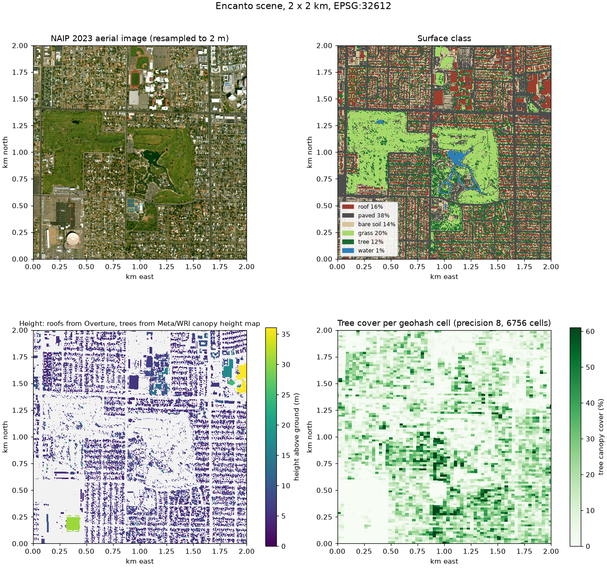
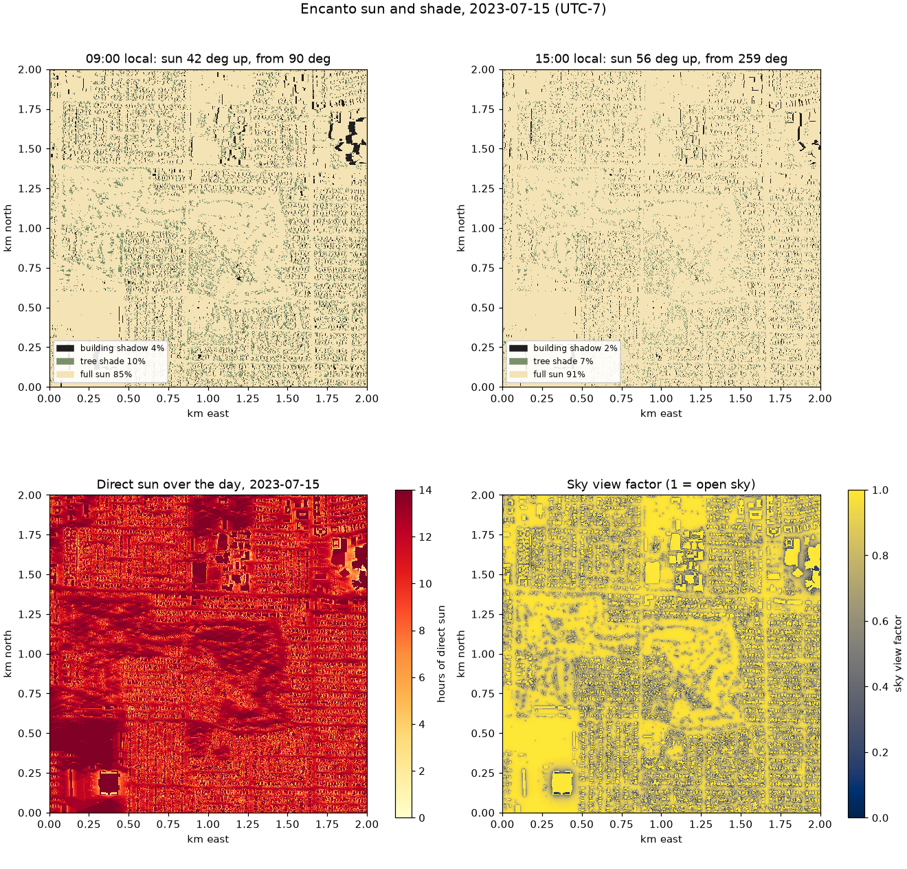
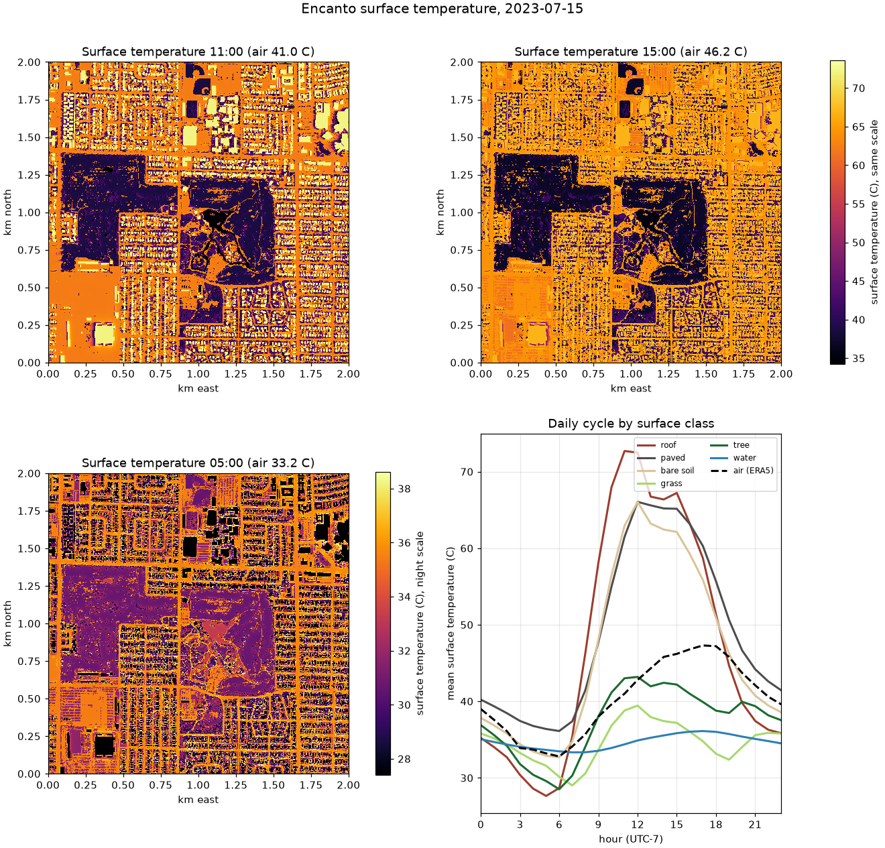

# urban-cooling-simulator

Physics-based simulation of street-level heat in a Phoenix neighbourhood: building and tree shading, surface energy balance and wind sheltering, and the cooling effect of trees, shade structures, cool roofs and porous paving, validated against Landsat surface temperature.

The study area is a 2 x 2 km square around Encanto Park in central Phoenix: a park with a lagoon, tree-lined historic residential streets, commercial corridors and large parking lots, so every surface type the simulator handles appears in one scene.

## Status

| Milestone | Content | State |
|---|---|---|
| 1. Scene builder | Buildings, roads, water, aerial imagery and heights on a 2 m grid; surface classes, heights and materials; geohash summary; Zarr | done |
| 2. Sun and shade | Sun position, hourly building and tree shadows, sky view factor | done |
| 3. Energy balance | Surface temperature from radiation, convection, storage and evaporation, with ERA5 forcing and wind sheltering | done |
| 4. Validation | Simulated surface temperature against Landsat Collection 2 surface temperature | done (results pending) |
| 5. Interventions | Trees, shade sails, cool roofs, porous paving; cooling maps and per-geohash tables | planned |

## Data (all free, no account)

| Layer | Source | Use |
|---|---|---|
| Building footprints and heights | Overture Maps `building` (via the `overturemaps` package) | roofs, fallback heights (height, else floors x 3.5 m) |
| Road centre lines | Overture Maps `segment`, subtype `road` | paved surface, buffered by road class |
| Water bodies | Overture Maps `water` (polygons) | lagoons, ponds, pools |
| Aerial imagery, 0.6 m RGB + NIR | USDA NAIP on Microsoft Planetary Computer | NDVI, brightness, surface class |
| Height above ground, 2 m | USGS 3DEP lidar `3dep-lidar-hag` on Planetary Computer | tree vs grass, roof heights (where available) |
| Canopy height, about 1 m | Meta/WRI High Resolution Canopy Height Maps v1 on AWS Open Data (no account) | tree vs grass and tree height when there is no lidar |
| Terrain | 3DEP lidar `3dep-lidar-dtm`, else Copernicus DEM GLO-30 (`cop-dem-glo-30`) on Planetary Computer | elevation |

Planetary Computer is read anonymously; only the part of each cloud-optimised GeoTIFF inside the scene is downloaded, warped straight onto the grid (NAIP averaged from 0.6 m to 2 m, lidar bilinear). Planetary Computer's 3DEP lidar collection has no coverage over Phoenix (checked for the whole metro area), so for Encanto the scene uses the fallbacks: tree height from the Meta/WRI canopy height map, roof height from Overture, and terrain from the 30 m Copernicus DEM. The canopy map is a model estimate from older Maxar imagery, not a measurement; over Encanto it gives 0 m for about three quarters of the vegetated pixels, which is why dark vegetation also counts as tree. NAIP is from 2023, so trees planted or removed in between are misclassified. The code still prefers lidar for any scene where it exists. The sources and dates used are recorded in `outputs/scene_summary.json`.

## Method (milestone 1)

1. **Grid.** A square, north-up 2 m grid in UTM 12N (EPSG:32612), corner snapped to the resolution, 1000 x 1000 pixels.
2. **Surface classes**, applied in order so that what is visible from above wins:
   - ground: bare soil, or paved if dark (asphalt, concrete, parking lots);
   - road buffers pave unvegetated pixels (verges and canopy inside the buffer keep their class);
   - vegetation (NDVI >= 0.20) is grass, or tree where its height (lidar, else canopy height map) is >= 2 m or where it is dark (mean RGB <= 70), since tree crowns are darker than irrigated turf;
   - water: Overture water polygons, plus any dark pixel with negative NDVI;
   - building footprints are roof.
   With no height source at all, trees fall back to the greenest vegetation (NDVI >= 0.35) at a nominal 6 m.
3. **Heights.** Roof height is the median lidar height inside each footprint, else the Overture height (or floors x 3.5 m), else 4 m; the canopy height map is never used for roofs. Canopy height is the vegetation height on tree pixels, or 6 m where that is missing or under 2 m (trees found by darkness).
4. **Materials.** Each class gets an albedo, a thermal emissivity and a relative evaporative fraction (`configs/encanto.yaml`), used by the energy balance in milestone 3.
5. **Geohash summary.** Every pixel is tagged with its precision-8 geohash (about 38 x 19 m); the table gives class fractions, mean albedo and mean building and canopy height per cell.

## Method (milestone 2: sun and shade)

1. **Sun position** from the NOAA solar calculator equations, with refraction. Checked against NREL's Solar Position Algorithm (pvlib) over a full year at Encanto: within 0.02 degrees in elevation and 0.03 degrees in azimuth.
2. **Shadows.** For each hour of the chosen day (15 July 2023, 06:00-19:00 MST; Arizona does not use daylight saving) a ray is marched from every pixel towards the sun over the building and canopy height rasters. A pixel's top surface (roof, crown or ground) is in full sun, in tree shade (25% of the direct beam passes through a crown), or in building shadow. Shadows are traced up to 300 m.
3. **Sky view factor**, the share of the sky hemisphere a surface sees, which controls how fast it cools by long-wave radiation at night: horizon angles in 32 directions out to 100 m, SVF = mean of cos^2(horizon angle). Tree crowns count as solid. Distances are measured to the near edge of the obstructing pixel; for an infinite street canyon with H/W = 1 the result at the centre matches the analytical value cos(atan(2H/W)) = 0.447 (Oke 1981) to within 0.003.
4. The scene is treated as flat: the terrain varies by a few metres across 2 km, far less than the buildings and trees. Pixels near the scene edge do not see obstructions outside it.

## Method (milestone 3: surface energy balance)

Every pixel's top surface is stepped through time (5-minute steps, two spin-up days with the real weather of the preceding days, then the target day):

C dTs/dt = K_abs + L_net - H - LE - storage

| Term | Model |
|---|---|
| Absorbed sun K_abs | (1 - albedo) x [direct x sunlit share (milestone 2) + diffuse x SVF + light reflected by surroundings x (1 - SVF)] |
| Long-wave L_net | emissivity x (L_in - sigma Ts^4); L_in = SVF x sky + (1 - SVF) x walls at air temperature; clear-sky emissivity from Brutsaert (1975) with a cloud correction |
| Convection H | h_c (Ts - Ta), h_c = 5.7 + 3.8 u (McAdams) with a free-convection floor; u = ERA5 10 m wind x (0.2 + 0.5 x SVF), so enclosed spaces are sheltered; crowns exchange heat from both leaf sides (x2), open water uses a lake bulk coefficient (x0.35) |
| Evaporation LE | grass and trees: rho L (qsat(Ts) - qa) / (r_a + r_s) with stomatal resistance r_s = r_s,min / (K / (K + 100)) (Jarvis 1976), so leaves close at night; other surfaces: evaporative fraction x the wet-surface rate |
| Storage | ground (paved, bare soil, grass): force-restore (Deardorff 1978) with thermal inertia; roofs: thin slab over an air-conditioned interior (U = 0.6 W m-2 K-1, 26 C); crowns: light slab; water: 1 m slab |

Weather is ERA5 from the Open-Meteo archive (free, no key): air temperature, dew point, pressure, 10 m wind, cloud cover, and direct and diffuse radiation on a horizontal surface. Radiation values are preceding-hour means and are centred on the half hour. Each step linearises the fluxes around the current surface temperature, so the update is stable for any step length.

On a clear synthetic Phoenix July day (air 31-44 C, dew point 8 C, wind 3 m/s, open sky) the model gives these early-afternoon surface temperatures, in line with published Phoenix measurements: dark roof 73 C, asphalt 66 C, bare soil 64 C, irrigated grass 38 C, tree crowns 43 C (about air temperature), pond 33 C; asphalt in all-day building shadow 37 C.

What it does not model: walls (only top surfaces), air temperature changes inside the neighbourhood (air comes from ERA5 for the whole scene), irrigation schedules, and heat from traffic and air conditioners.

## Method (milestone 4: validation against Landsat)

1. **Scene.** Landsat 8 and 9 Collection 2 Level-2 surface temperature (ST_B10, scaled DN x 0.00341802 + 149 K) from Planetary Computer. Of the scenes in the search window with under 20% cloud, the one closest to the simulation date that is at least 98% clear over the 2 x 2 km scene (CFMask: no fill, cloud, dilated cloud, cirrus or shadow) is used.
2. **Simulation at the overpass.** Sun and shade, ERA5 forcing and the energy balance are rerun for the Landsat date and the surface temperature is taken at the overpass time (about 10:50 MST), without overwriting the main-day outputs.
3. **Matching resolution.** Landsat ST is delivered at 30 m but measured by TIRS at 100 m, so both are averaged to 100 m and 200 m blocks (2 m simulation pixels and Landsat read at 10 m with nearest neighbour). Blocks less than 90% clear are dropped.
4. **Scores.** Bias (simulated - Landsat), MAE, RMSE, RMSE after removing the bias, and the correlation, for all blocks and by each block's dominant surface class.

Expected differences: Landsat sees walls and the ground under crowns at an angle the model does not, uses ASTER emissivities from 2000-2008, and its own ST uncertainty is about 1-2 K; the model's air temperature and wind come from one 25 km ERA5 cell.

## Scene result (Encanto, 2 x 2 km)



| Class | Share |
|---|---|
| paved (roads, parking, driveways) | 37.6% |
| grass | 19.5% |
| roof | 16.0% |
| bare soil | 13.7% |
| tree | 12.3% |
| water | 0.8% |

3,104 buildings (median roof height 4.6 m, 95th percentile 30.7 m) and 6,756 geohash cells. The park lawns and golf course are grass, the lagoon and its channels are water, and tree canopy follows the residential yards, street rows and park paths. Sources: NAIP 2023-09-17, Overture building, road and water layers, Meta/WRI canopy height map (no 3DEP lidar over Phoenix on Planetary Computer), Copernicus DEM.

## Sun and shade result (15 July 2023)



The sun rises in the east-north-east and peaks at 77 degrees just after 12:30 MST. At 09:00 buildings shadow 4% of the scene and trees shade 10%; at 15:00, 2% and 7%; at 06:00 and 19:00, long shadows leave only 38% and 47% in full sun.

| Surface | Hours of direct sun (06:00-19:00, max 14) | Sky view factor |
|---|---|---|
| roof | 13.1 | 0.95 |
| tree crown | 12.3 | 0.84 |
| water | 11.9 | 0.86 |
| grass | 11.1 | 0.77 |
| paved | 10.9 | 0.78 |
| bare soil | 10.5 | 0.75 |
| scene mean | 11.4 | 0.81 |

Roofs are almost always in full sun with open sky, which is why cool roofs are one of the interventions in milestone 5. Ground surfaces lose about 2-3 hours of sun to buildings and trees, and see a quarter less sky, so they keep more heat at night.

## Surface temperature result (15 July 2023)



ERA5 air temperature ranged from 32.8 C (06:00) to 47.3 C (17:00); passing cloud cut the direct sun at 12:00-13:00 and 15:00-16:00, which shows as midday dips in the dry surfaces.

| Surface | 05:00 | 11:00 | 15:00 | Daily max | Main heat loss at 15:00 (W m-2) |
|---|---|---|---|---|---|
| roof | 27.6 | 72.7 | 67.2 | 72.7 | convection 299, long-wave 244 |
| paved | 36.4 | 61.5 | 65.2 | 66.1 | convection 248, long-wave 223 |
| bare soil | 32.9 | 62.9 | 62.1 | 66.0 | convection 206, long-wave 189 |
| tree crown | 29.6 | 43.0 | 42.2 | 43.2 | evaporation 611 |
| grass | 31.6 | 38.8 | 37.2 | 39.4 | evaporation 598 |
| water | 33.7 | 34.4 | 35.8 | 36.1 | evaporation 356 |
| scene mean | 32.7 | 56.6 | 56.6 | | |

The park is about 25 C cooler than the surrounding streets in the afternoon; grass and crowns run below air temperature and even take heat from the air (negative convection). At night the pattern turns over: light roofs cool fastest (radiating to a dry sky, 6 C below air), while asphalt stays above air temperature from the heat it stored during the day, the usual night-time urban heat island signature.

## Setup

```powershell
git clone https://github.com/SaraEwaida/urban-cooling-simulator.git
cd urban-cooling-simulator
python -m venv .venv
.\.venv\Scripts\Activate.ps1
pip install -e ".[dev]"
pytest -q
```

## Run

```powershell
ucs fetch    # Overture vectors, NAIP and lidar onto the grid (a few minutes, needs internet)
ucs scene    # classes, heights, materials -> data/encanto/scene.zarr, geohash table, summary, figure
ucs sun      # hourly shade and sky view factor -> data/encanto/sun.zarr, geohash table, summary, figure
ucs heat     # ERA5 forcing (downloaded once) and the energy balance -> data/encanto/heat.zarr, tables, figure
ucs validate # Landsat scene, simulation at its overpass, scores and figure
```

Outputs:

- `data/encanto/scene.zarr`: all layers on the grid (`surface_class`, `building_height`, `canopy_height`, `albedo`, `emissivity`, `evap`, `ndvi`, `naip`, `terrain`, ...), with CRS, transform, class codes and source metadata in the attributes.
- `outputs/geohash_cells.csv`: per-geohash class fractions, albedo and heights.
- `outputs/scene_summary.json`: class fractions, building count, heights, source items and dates.
- `outputs/figures/encanto_scene.png`: imagery, classes, heights and tree cover per geohash.
- `data/encanto/sun.zarr`: hourly sunlit share (`time, y, x`), sunlit hours, sky view factor, sun elevation and azimuth.
- `outputs/geohash_sun.csv`: per-geohash sky view factor, sunlit hours (all surfaces and ground only) and shade at 09:00 and 15:00.
- `outputs/sun_summary.json`: sun path for the day and sunlit hours and sky view factor by surface class.
- `outputs/figures/encanto_sun.png`: shade at 09:00 and 15:00, hours of direct sun, sky view factor.
- `data/encanto/forcing.csv`: hourly ERA5 weather for the spin-up days and the target day.
- `data/encanto/heat.zarr`: hourly surface temperature for the target day, daily maximum, air temperature.
- `outputs/geohash_heat.csv`: per-geohash surface temperature at 11:00, 15:00, 05:00 and the daily maximum.
- `outputs/heat_summary.json`, `outputs/heat_by_class_hourly.csv`: temperatures and energy fluxes by surface class.
- `outputs/figures/encanto_heat.png`: surface temperature maps (11:00 and 15:00 on one scale, 05:00) and the daily cycle by class.
- `outputs/validation.json`: Landsat scene and overpass time, scores at 100 m and 200 m, overall and by dominant class.
- `outputs/validation_blocks.csv`: every 100 m block with simulated and Landsat temperature and its dominant class.
- `outputs/figures/encanto_validation.png`: Landsat and simulation on one scale, their difference, and a scatter by class.

## Tests

Validation tests: block averaging with clouds, dominant class, recovery of a known +2 C bias, the CFMask bits and the USGS scale-factor example, and an end-to-end run with a stand-in Landsat scene checking that the simulation is taken at the overpass time.

Energy balance tests: a dry surface with no sun among walls at air temperature relaxes exactly to air temperature, the update stays finite with one-hour steps, the afternoon ordering of surfaces on a synthetic Phoenix day (roof > asphalt > bare soil > air > tree, grass), shade and a higher albedo both cool asphalt, vegetation stops transpiring at night, forcing parsing and the half-hour radiation shift, and an end-to-end run writing the Zarr, tables and figure.

Sun and shade tests: solstice noon elevation (90 - latitude + 23.44 degrees) and Arizona solar noon, a morning sun in the east and none at night, the shadow length of a 10 m block at a 45 degree sun, partial tree shade with buildings taking precedence, sky view factor 1 on open ground and the analytical street canyon value, and the written Zarr, table and figure.

Scene tests run offline on a synthetic 200 m scene (grass with a tree clump, bare ground, a building, a road and a pond) and check the geohash encoder against published reference values, grid snapping, every class rule, the roof height fallbacks, material lookup and the written Zarr, table and figure.

## Layout

```
configs/encanto.yaml      scene, thresholds, road widths, materials, paths
src/ucs/grid.py           projected grid, lon/lat of pixel centres
src/ucs/geohash.py        vectorised geohash encoder
src/ucs/overture.py       buildings and roads from Overture Maps
src/ucs/imagery.py        NAIP and 3DEP lidar from Planetary Computer, warped onto the grid
src/ucs/rasterize.py      footprints and buffered roads onto the grid
src/ucs/classify.py       surface classes, heights, material maps
src/ucs/scene.py          fetch and build steps, Zarr, geohash table, summary
src/ucs/solar.py          sun elevation and azimuth (NOAA equations)
src/ucs/shade.py          ray-marched shadows and sky view factor
src/ucs/sun.py            hourly shade over a day, geohash table, summary
src/ucs/forcing.py        ERA5 weather from Open-Meteo, time interpolation
src/ucs/energy.py         per-pixel surface energy balance
src/ucs/heat.py           runs the day, geohash table, summary
src/ucs/landsat.py        Landsat surface temperature and cloud mask from Planetary Computer
src/ucs/validate.py       simulation at the overpass, block scores
src/ucs/plots.py          scene, sun, heat and validation figures
src/ucs/cli.py            `ucs fetch | scene | sun | heat | validate | all`
```
